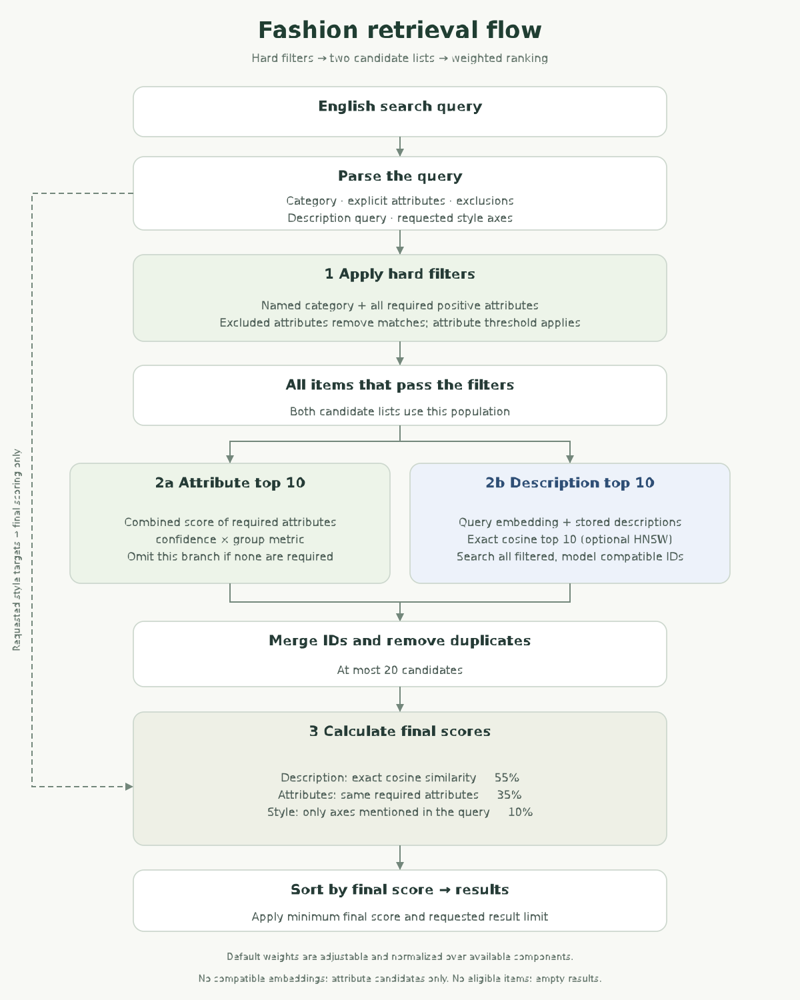

# FashioNavi

**Fashion Navigator with Attribute-Enriched Graphs and Hybrid Retrieval**

[Jiyoon Myung†](https://www.linkedin.com/in/jiyoon-myung), [Yujin Jung†](https://www.linkedin.com/in/유진-정-59b296258), [Mia Lim†](https://www.linkedin.com/in/seoyounglim), [Youjin Jeon†](https://www.linkedin.com/in/youjinjeon), and Jaein Kim†  

*NaVi LAB, Seoul, Republic of Korea · † Equal contribution*

<p align="center">
  <strong>📄 Paper (link pending) | <a href="https://github.com/NaVi-LAB-Modulabs/Fashion-Retrieval-Demo">💻 Code</a> | <a href="https://fashion-retrieval-demo.vercel.app/">🚀 Live Demo</a></strong>
</p>

## 📝 Abstract

Natural-language fashion queries often combine explicit product requirements with subjective style preferences, making them difficult to satisfy with a single similarity score. We present **FashioNavi**, a hybrid fashion retrieval system that combines an attribute-enriched product graph, vision-language model (VLM)-generated descriptions, and fine-grained style axes. FashioNavi decomposes each query into attribute constraints, a visual description, and style targets. It then applies graph-based filtering and semantic retrieval, followed by hybrid reranking. The interactive demo makes the retrieval process transparent by showing parsed queries, item-level evidence, and component scores. Adjustable settings and an unfiltered CLIP baseline allow users to explore how each retrieval signal affects the results.

## 🔎 Overview

FashioNavi consists of two stages:

- **Offline graph construction:** Extract typed product attributes, seven reference-grounded style scores, and VLM-generated descriptions designed to distinguish each item from visually similar garments retrieved by CLIP.
- **Online retrieval:** Parse the user's query, apply hard constraints, combine the top 10 candidates from attribute matching with the top 10 from description similarity, and rerank the merged candidates using attribute, semantic, and style evidence.



The default scoring weights are **55% description · 35% graph attributes · 10% style**. Weights are configurable and are renormalized over the available scoring components.

> **Scope:** This repository contains the online retrieval service and interactive demo. The offline graph-construction pipeline is maintained separately.

## 📂 Repository Structure

```text
web_app.py                  # FastAPI application and API
preview.py                  # Catalog preview server
web/                        # Frontend and style references
src/fashion_how_graphdb/    # Query parsing, retrieval, and reranking
public/images/              # Product images
data/clip/                  # Standalone CLIP index
scripts/                    # Index building and evaluation
tests/                      # Automated tests
docs/                       # Experiment details
```

## ✨ Demo

Try a natural-language query such as:

> A casual day dress with long sleeves, but not a black one.

The demo lets you:

- Inspect parsed constraints, item-level supporting evidence, and component scores.
- Adjust scoring weights, thresholds, and style-target modes.
- Compare FashioNavi results with the **unfiltered CLIP ViT-L/14 baseline** used in the paper.
- Inspect generated Cypher queries and execution timings, then export complete search runs as JSON.

The live demo covers **15,000 Fashion200K images** across five garment categories.

## 🚀 Quick Start

### 1. 🌐 Try It Online

Open the **[Live Demo](https://fashion-retrieval-demo.vercel.app/)**. No installation is required.

Example queries:

- `A soft, elegant maxi dress with a V-neck and short sleeves`
- `A navy jacket with waist pockets, without a zipper`
- `A minimal black midi skirt with a slit, not pleated`

### 2. 💻 Run Locally (No API Keys)

**Requirements:** Python 3.11–3.13. The repository includes approximately 280 MB of catalog images, so cloning may take some time.

```bash
git clone https://github.com/NaVi-LAB-Modulabs/Fashion-Retrieval-Demo.git
cd Fashion-Retrieval-Demo
python3 -m venv .venv
source .venv/bin/activate          # Windows: .venv\Scripts\activate
pip install -r requirements.txt
python web_app.py
```

Open <http://127.0.0.1:7860> in your browser.

Without OpenAI and Neo4j credentials, the application automatically switches to **CLIP ONNX mode**: CPU-based text-to-image retrieval using **CLIP ViT-B/32** over **5,000 bundled images**. On the first search, it downloads a pinned model file (approximately 64 MB) from Hugging Face, so an internet connection is required. Subsequent searches are faster.

To preview the interface without installing the full application, run `python preview.py`. This launches an unranked catalog preview with search disabled.

### 3. 🗃️ Run the Full FashioNavi Pipeline

Full hybrid retrieval requires an **OpenAI API key** and a **Neo4j database populated with the FashioNavi fashion graph**.

> **Graph data release pending.** Download and restore instructions will be added once the Neo4j graph data is available. Until then, you can explore the full pipeline through the [live demo](https://fashion-retrieval-demo.vercel.app/).

Once the graph data is released:

1. Install **Neo4j 5.23 or later** using [Neo4j Desktop](https://neo4j.com/download/) or the [official Docker image](https://hub.docker.com/_/neo4j).
2. Restore the released graph data into your Neo4j database.
3. Copy `.env.example` to `.env` and configure the variables below.
4. Start the application:

```bash
cp .env.example .env               # Windows: copy .env.example .env
python web_app.py
```

| Variable | Required | Default or example |
| --- | --- | --- |
| `OPENAI_API_KEY` | Yes | — |
| `NEO4J_URI` | Yes | `bolt://localhost:7687` for a local installation |
| `NEO4J_PASSWORD` | Yes | — |
| `NEO4J_USERNAME` | No | `neo4j` |
| `NEO4J_DATABASE` | No | Server default |
| `OPENAI_MODEL` | No | `gpt-5.4-mini` (pinned to `gpt-5.4-mini-2026-03-17`) |
| `OPENAI_EMBEDDING_MODEL` | No | `text-embedding-3-large` |

When the credentials and graph are configured, the application header displays **Live search configured**, and **Hybrid** becomes the default retrieval mode.

## 🎛️ Using the Interface

- **Search bar:** Describe an item in plain English. Negations such as “not white” and “without a zipper” are converted into exclusion filters.
- **Search settings (collapsible):**
  - **Retrieval mode:** Choose *Hybrid* (full FashioNavi) or *CLIP ONNX* (standalone CLIP search).
  - **Style targets:** Choose *Image references* to calibrate style targets using labeled reference images, or *Legacy* for text-only targets.
  - **Scoring weights:** Adjust description, graph-attribute, and style weights (default: **55 : 35 : 10**).
  - **Thresholds:** Set the minimum attribute match and minimum final score.
- **Results:** Each card displays its final score and component scores (**G** = graph attributes, **T** = text description, **S** = style). Open a card to inspect matched attributes and style-axis values.
- **How this search was ranked:** Examine extracted constraints, generated Cypher and its parameters, and stage-by-stage timings.
- **Show CLIP results:** Expand a separate **CLIP ViT-L/14** baseline. It is collapsed by default to distinguish baseline output from FashioNavi results; overlapping items are marked.
- **Export:** Download the complete search run as JSON.

## 🧠 How It Works

1. **Parse:** An LLM extracts the product category, required and excluded attributes, a visual description, and requested style-axis targets.
2. **Filter:** Neo4j applies hard constraints on category and required/excluded attributes before ranking.
3. **Select candidates:** Retrieve the top 10 filtered items by graph-attribute score and the top 10 by description-embedding similarity. Merge and deduplicate the two sets to obtain at most 20 candidates.
4. **Rerank:** Compute a weighted mean of description similarity, graph-attribute match, and style-axis closeness. Missing components are excluded, and the remaining weights are renormalized.

## 🔌 API

The FastAPI server exposes a JSON API, with interactive documentation at **`/docs`**.

| Endpoint | Requirements | Purpose |
| --- | --- | --- |
| `POST /api/clip/search` | No API keys or database | CLIP ViT-B/32 search over 5,000 bundled images |
| `POST /api/search` | OpenAI + Neo4j | Full FashioNavi hybrid retrieval |
| `POST /api/baseline` | Neo4j | CLIP ViT-L/14 baseline using graph image embeddings |
| `GET /api/config` | None | Server readiness and default settings |

Example request for local CLIP search:

```bash
curl -X POST http://127.0.0.1:7860/api/clip/search \
  -H "Content-Type: application/json" \
  -d '{"query": "a formal black dress", "limit": 5}'
```

The `/api/search` endpoint accepts the following fields:

- `query`: Natural-language search request.
- `limit`: Number of returned results (1–50).
- `model`: Model selection.
- `style_mode`: `legacy` or `reference` (**API default: `legacy`**).
- `weights`: Object containing `text`, `graph`, and `style` weights.
- `min_confidence`: Minimum attribute-match threshold.
- `min_score`: Minimum final-score threshold.

## 🧪 Development

Install the development dependencies and run the automated tests:

```bash
python -m pip install -r requirements-dev.txt
python scripts/run_tests.py
```

See the [CLIP ONNX comparison](docs/clip-onnx-comparison.md) and [style-reference experiment](docs/reference-style-experiment.md) for implementation details and evaluation results. Vercel deployment settings are defined in `pyproject.toml` and `vercel.json`.

## ⚖️ License

This project is licensed under the **MIT License**.