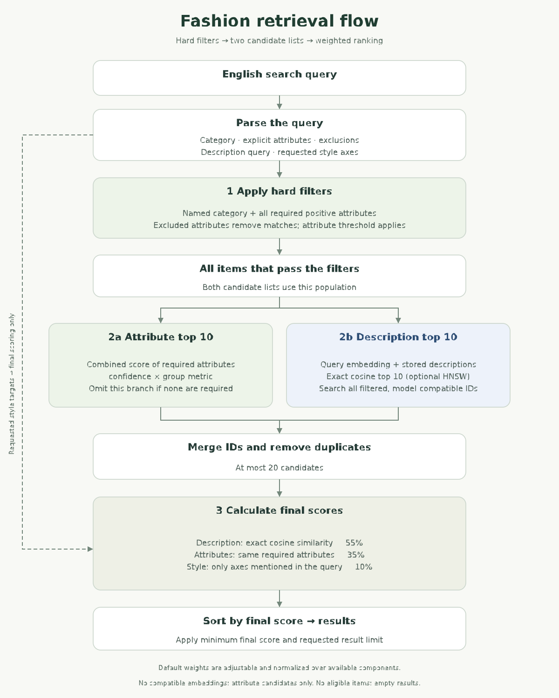

# FashioNavi

*Navigating Fashion Retrieval through Knowledge Graphs and Interpretable Style Axes*

**Live demo:** <https://fashion-retrieval-demo.vercel.app/>

FashioNavi is a research prototype for explainable natural-language fashion
retrieval. It combines LLM-based query parsing, knowledge-graph filtering,
description-vector retrieval, and interpretable style-axis reranking. The demo is
intended for information-retrieval researchers and practitioners who want to
inspect not only the ranked garments, but also the constraints, candidates,
component scores, Cypher query, and timings that produced the ranking.

## Demo overview

Enter a request such as “a casual blue shirt, not white, for daily wear.” The
system extracts positive and excluded constraints, retrieves candidates from a
Fashion200K knowledge graph, and presents ranked garments with an explanation of
each retrieval stage.

The live demo provides:

- natural-language search with positive and excluded constraints;
- graph and description-vector candidate retrieval;
- interpretable style-axis targets and weighted reranking;
- per-item component scores and mapped attributes;
- generated Cypher, redacted parameters, and measured stage timings;
- downloadable JSON run data; and
- two clearly separated CLIP comparisons described below.

The initial gallery is an **unranked catalog preview**. It does not contain
invented scores or attributes, and it should not be interpreted as a search
result. Live results are always returned by the retrieval service.

## System interface

The web UI uses the dataset-independent name **FashioNavi**. The current research
demo uses **Fashion200K**; the dataset name is retained in experiment and
provenance documentation rather than used as the product identity. The initial
preview displays images listed in `sample_ids.json` without querying Neo4j.

The web UI is laid out like a shopping search page: a large search bar with
collapsible settings at the top, then ranked product results beside an extracted-constraints
rail, followed by a "How this search was ranked" section with stage timings, the final
candidate Cypher and its parameters. Cypher stays visible without opening an accordion. Parameter values, applied
settings and measured stage timings are shown alongside the query. Image cards
include component scores; a table and item details provide more ranking evidence.
Raw parser/parameter JSON and run export remain available for inspection.
Before a search, analysis panes show empty states rather than fabricated examples.

The interface is plain HTML, CSS, and JavaScript served by FastAPI; no Node.js or
frontend build is required. The application entry point is `web_app.py`.

## Run locally

Use Python 3.11–3.13 and Windows Command Prompt:

```cmd
python -m venv .venv
.venv\Scripts\python.exe -m pip install -r requirements.txt
.venv\Scripts\python.exe web_app.py
```

Open `http://127.0.0.1:7860`. Configure the variables below in a root `.env` file
or the server environment to enable live search. Credentials stay on the server.

The status indicator reports configuration presence, not verified connectivity.
No local GPU is required by the web retrieval path.

### Credential-free preview

To inspect the interface without installing packages or calling external
services:

```cmd
python preview.py
```

This starts the same UI on port 7860 with live search explicitly disabled. Stop
it with Ctrl+C before starting `web_app.py` on the same port.

### Standalone CLIP ONNX search

Choose **Retrieval: CLIP ONNX** to search the packaged 5,000-image catalog using
OpenAI CLIP ViT-B/32 on CPU, without OpenAI/Neo4j credentials or PyTorch. Hybrid
search can also return same-candidate reranking and full-catalog CLIP results
through the API (`compare_clip`); the UI does not show them. Scores are raw CLIP
cosines, not hybrid weighted scores. First use downloads a pinned text ONNX
model and tokenizer to temporary storage. See [model provenance, algorithms,
API requests and Recall@K evaluation](docs/clip-onnx-comparison.md).

## Deploy to Vercel

Import this repository into Vercel and select the **FastAPI** framework preset.
`pyproject.toml` specifies `web_app:app` as the entrypoint and lists the application
dependencies. `.vercelignore` excludes local environment files, development
artifacts and the preview server from uploads. There is no frontend build command. Set
`OPENAI_API_KEY`, `NEO4J_URI`, `NEO4J_USERNAME` and `NEO4J_PASSWORD` in the project
environment, plus any optional model/database settings listed below. Redeploy
after changing environment variables. Use a Neo4j endpoint reachable from the
deployment. API reference: `/docs`.

Static UI assets are mounted at `/assets`. Product images live in `public/images/`,
which Vercel serves from its CDN at `/images/...`; `vercel.json` excludes `public/`
from the function bundle. Locally, `/images/{filename}` serves only files whose IDs
are listed in `sample_ids.json`. Missing images display a placeholder.
Review the function duration available to the project before a live demo: parser
and embedding calls can take time, especially when provider retries are needed.

The graph-backed [ViT-L/14 baseline](#graph-backed-clip-vit-l14-baseline) needs
Neo4j credentials but not an OpenAI API key. Each instance downloads its pinned
248 MB text encoder and tokenizer from Hugging Face into temporary storage on
first use. Allow outbound HTTPS to Hugging Face and expect a slower first request
after a cold start. This baseline is distinct from the packaged 5,000-image
ViT-B/32 ONNX search, which does not use Neo4j.

Vercel configuration follows the [official FastAPI deployment guide](https://vercel.com/docs/frameworks/backend/fastapi).

## Verification

```cmd
python -m unittest discover -s tests -v
```

The service tests use provider doubles to verify real Cypher generation,
reranking, thresholds, safe response fields and preview semantics without API
charges. They do not establish connectivity to a deployed database or provider.

The ONNX download test is skipped unless `FASHION_CLIP_DOWNLOAD_TESTS=1` is set;
it downloads the 248 MB model.

## Operational limitations

- Full FashioNavi search requires both OpenAI and Neo4j credentials; the
  standalone ViT-B/32 CLIP mode requires neither.
- The graph dataset and its stored embeddings must already exist. Graph creation
  and attribute extraction are outside this repository.
- Serverless cold starts can require a model download and do not preserve the
  default SQLite cache across instances or redeployments.
- CLIP scores are comparison signals, not calibrated relevance probabilities.
- The included offline tests validate service behavior with provider doubles;
  they do not replace a live connectivity or retrieval-quality evaluation.

## Environment variables

Set these in the server environment or a local `.env` file. For deployment,
register the values in the Vercel project's environment variables:

```text
OPENAI_API_KEY
NEO4J_URI
NEO4J_USERNAME
NEO4J_PASSWORD
```

Optional:

```text
NEO4J_DATABASE
OPENAI_MODEL
OPENAI_EMBEDDING_MODEL
FASHION_CACHE_ENABLED
FASHION_CACHE_PATH
FASHION_CACHE_TTL_SECONDS
FASHION_CACHE_MAX_ENTRIES
FASHION_DATASET_REVISION
FASHION_VECTOR_SEARCH_MODE
```

### Reproducible searches

Successful query parsing, query embeddings, and full web search results are cached
in SQLite by default. Locally, the file is `.cache/retrieval.sqlite3` and survives
server restarts. Parsing and embedding caches also apply to the CLI. The full
search cache includes normalized query text, resolved parser model, embedding
model, database identity, vector search mode/index, thresholds, weights, and result
limit. Source/taxonomy changes invalidate entries automatically on server restart.
Concurrent identical misses share a SQLite lease so local workers compute once;
failed calls are not stored. Whitespace and Unicode NFC are normalized, while
case and punctuation are preserved.

Known UI model aliases are pinned to snapshots: `gpt-5.4-mini-2026-03-17`,
`gpt-4.1-mini-2025-04-14`, and `gpt-4.1-2025-04-14`. Explicit snapshot IDs and other
model IDs are preserved. GPT-4.1/GPT-4o requests use `temperature=0`; reasoning
models retain compatible provider defaults. The Responses API does not expose
`seed`, so no unsupported seed is sent. Provider prompt caching is distinct from
this application's saved-result cache and does not freeze generated answers.
See the official [Responses API reference](https://developers.openai.com/api/reference/python/resources/responses/methods/create)
and [GPT-5.4 mini snapshots](https://developers.openai.com/api/docs/models/gpt-5.4-mini).

`FASHION_VECTOR_SEARCH_MODE=exact` is the default. It calculates cosine similarity
over every model-compatible item that passed the graph filters and sorts by score,
then ID, before selecting 10 description candidates. This removes ANN candidate
approximation but can be slower with broad queries. Set it to `hnsw` to restore
filtered approximate search; a full search cache hit skips both search modes.
Filter lists are deduplicated and sorted; mapped attributes and style targets also
have a stable order. Final score ties are resolved by item ID.

Cache entries have no time expiry by default (`FASHION_CACHE_TTL_SECONDS=0`), with
up to `FASHION_CACHE_MAX_ENTRIES=4096` entries per layer. Set a positive TTL for
freshness or `FASHION_CACHE_ENABLED=0` to bypass all layers. After changing graph
data, stored embeddings, local image files, or the vector index, increment
`FASHION_DATASET_REVISION` in `.env` or the deployment environment and restart or
redeploy. Cached searches intentionally keep the old result until invalidation,
expiry, or eviction; database changes are not detected automatically. Keep the
dataset immutable during a demo for uncached queries as well.

Web responses include `cache.hit`, `cache.created_at`, original computation
timings, and a SHA-256 query embedding fingerprint. A cache hit reports zero
parser/graph/reranking time and measures cache retrieval separately in `total_ms`;
the UI labels reused results. Durations and cache status are operational metadata
and can still differ between requests.

On Vercel, the default file lives in the instance's temporary directory. It is
neither shared across instances nor durable across cold starts/redeployments.
`FASHION_CACHE_PATH` can point to a writable persistent filesystem on a local or
stateful server. A multi-instance serverless deployment needs a shared cache
backend to preserve the first answer globally. The current SQLite implementation
coordinates only workers sharing the same file. Do not upload local caches;
they contain query text and saved search results.

## Data provenance and usage

`sample_ids.json` lists 15,000 Fashion200K IDs across five categories (3,000 per
category). All corresponding images are stored as `public/images/<id>.jpg`
(about 262 MB), including the 10,000 added images extracted from the cached
Hugging Face dataset. No runtime image download is needed.

The images and identifiers originate from the
[`Marqo/fashion200k`](https://huggingface.co/datasets/Marqo/fashion200k)
distribution of Fashion200K. Its dataset card identifies the distribution as
Apache-2.0, states that Marqo does not own the original dataset, and asks users to
cite the original work. Users who redistribute or publicly deploy the included
images are responsible for confirming that their use complies with the original
dataset terms and any applicable image rights. The repository's software and
third-party data should therefore be treated as separate licensing concerns.

Image URLs are built from `sample_ids.json`, not from the filesystem, because the
deployed function does not contain `public/`. Locally the web app and `preview.py`
serve only files in `public/images/` whose IDs appear in the manifest. They make no
Hugging Face image requests. Search results outside the manifest retain their ranking
evidence and show an image placeholder. Commit `sample_ids.json` and the
`public/images/` files when preparing the deployment.

## Repository structure

```text
.
|-- web_app.py                     # FastAPI application entrypoint
|-- preview.py                     # dependency-free UI preview (local images)
|-- web/                           # HTML, CSS, JavaScript and favicon
|-- requirements.txt              # application dependencies for local install
|-- pyproject.toml                 # dependencies and Vercel entrypoint
|-- vercel.json                    # FastAPI preset; keeps public/ out of the function
|-- tests/                         # offline service and preview tests
|-- sample_ids.json               # allowed Fashion200K image IDs
|-- public/images/                # saved Fashion200K images (CDN on Vercel)
|-- scripts/
`-- src/
    `-- fashion_how_graphdb/
        |-- web_service.py         # retrieval API adapter and image catalog
        |-- search.py              # query parsing and CLI
        |-- hybrid_search.py       # vector/graph candidate union and reranking
        |-- baseline.py            # CLIP text-to-image baseline
        |-- neo4j_config.py        # Neo4j connection defaults
        |-- taxonomy.py
        |-- category_taxonomy.py
        `-- llm.py                 # text-only search query parsing
```

## Retrieval method

This repository searches an existing Fashion200K graph. Image attribute
extraction and graph import are handled by the separate Fashion-Retrieval
project and are not reproduced here.
Search uses `(Item)-[:IS_CATEGORY]->(Category)` and the English taxonomy IDs.
The query parser identifies the category, positive and excluded graph attributes,
directly named attributes, a positive visual description, and requested
style axes. Category, required attribute and excluded attribute filters run
before candidate selection. Within the filtered items, two independent lists
are selected: the top 10 by the combined graph attribute score and the top 10 by
description similarity using exact cosine by default (optional filtered HNSW). Their IDs are merged and deduplicated, giving at most
20 candidates for final scoring. With no required attributes, only the description
list is used. The final result limit does not enlarge either candidate list.
Directly named positive
attributes such as "white" in "white jacket" require a matching graph edge;
the same required attributes supply graph candidates and the attribute score.
Inferred attributes stay in the parsed output but do not affect graph candidates
or the attribute score. Excluded attributes only remove matching items.
Attribute filtering and graph scoring both use `confidence * metric`: color
coverage, pattern/category prominence, or season score. Materials and attributes
without a metric use confidence alone. `min_confidence` is retained as the API/CLI
parameter name, but now thresholds this attribute match score. The web UI labels
it **Min. attribute match**. A threshold of zero leaves low-coverage matches
eligible; raise it to require stronger matches.
Final scoring combines description
similarity (55%), matching graph edges (35%), and mentioned style axes (10%);
weights are normalized across available components. Color, pattern and category
attributes carry full graph weight; materials and seasons are weaker signals.
The web settings expose description, graph-attribute, and style weights under
**Scoring weights**. Their default relative values are 55:35:10. The UI shows
the effective split as values change; each search sends its chosen weights to
the API. At least one weight must be above zero, and unavailable or zero-weight
score components are omitted before the remaining weights are normalized.

### Retrieval flow



[Download the PNG diagram](web/search-flow.png). Both branches use the entire
hard-filtered population; the description branch additionally requires a matching
embedding model. Style targets affect final scoring only.
To regenerate the SVG and PNG with Pillow installed:

```cmd
python scripts\render_search_flow.py
```

## Graph-backed CLIP ViT-L/14 baseline

For research comparison, each search also runs a plain CLIP baseline. It appears above
the FashioNavi results but stays collapsed so it is not mistaken for them: a
**Show CLIP results** button opens it, and every new search collapses it again. It
usually returns first, so while the main search runs a note says its results can be
checked in the meantime; when the main results arrive the page scrolls to them (after
any open item dialog closes). The raw query text (not the parsed description) is
encoded by the CLIP ViT-L/14 text encoder and every `Item` is ranked by exact cosine
similarity with its stored `image_embedding`. There is no query parsing, hard filtering, graph scoring or
reranking, so exclusions such as "not white" are not enforced. Scores are raw cosine
values in [-1, 1]: Neo4j's `vector.similarity.cosine` returns `(1 + cosine) / 2`, so the
query rescales it. The CLIP tokenizer truncates queries beyond 77 tokens.

The image vectors came from the `sentence-transformers` model `clip-ViT-L-14` (fp32,
normalized). The query uses the same OpenAI ViT-L/14 text tower as an fp16 ONNX export
on Hugging Face ([`Xenova/clip-vit-large-patch14`](https://huggingface.co/Xenova/clip-vit-large-patch14),
pinned revision and checksums in `baseline.py`), run with `onnxruntime` and the
standalone `tokenizers` package, so PyTorch is not needed and no model file is
deployed. Like the CLIP ONNX comparison, the server downloads it on first use and
verifies it before loading. Against the fp32 model its query embeddings agree at
cosine 1.0000, and on 8 test queries (including non-English and emoji input) the
top-12 baseline results from Neo4j were identical to those of the earlier self-exported
model, with scores within 0.00004. The int8 export in the same repository is not
used: its query embeddings drift to cosine 0.83-0.91.

The baseline scans all items rather than the binary-quantized `item_image_embedding`
ANN index, so results are exact (about 1 s for 5,000 items on Aura). It is served by
`POST /api/baseline` with `{"query", "limit"}`, needs only the Neo4j settings (not
OpenAI), and is requested in parallel with the main search. Items that
also appear in the FashioNavi results are marked, and the run export includes the
baseline list. The server downloads and loads the model in the background at startup.

Required `Item` properties:

```text
image_embedding          # 768 dimensions, L2-normalized
image_embedding_model    # clip-ViT-L-14
```

## Neo4j Item Properties

Reference style calibration uses required axis keys, per-axis score ranges, and
one allowed supporting image ID per axis. If calibration is unavailable, search
continues with text-based style targets and displays an explicit notice. These
fallback results are not cached. See [reference design and recovery behavior](docs/reference-style-experiment.md).

### Experimental image-reference style targets

The web UI now offers **Image references** and **Legacy** target modes. Image
references sends the existing labeled calibration garments to the model at
query time. The API's `compare_styles` reranks the identical candidate pool with both
target sets (the UI does not show this comparison), with reference images, confidence and target changes in the
inspector. Stored item axes and retrieval weights remain unchanged. The API
defaults to legacy for compatibility. See
[the experiment notes](docs/reference-style-experiment.md) for provenance,
limits, request fields and evaluation guidance.

For Fashion200K images, each `Item` should preserve the Hugging Face `item_ID`
as `id` (or supply a separate `item_ID` property). Only IDs in `sample_ids.json`
receive an image URL.

Live search requires `Item.description_embedding` with 3,072 dimensions,
`Item.description_embedding_model` set to `text-embedding-3-large`.
The query embedding must use the same model and dimensions as stored items.
Set `OPENAI_EMBEDDING_MODEL` if the stored item vectors use another model.
The default exact mode does not require a vector index and scans all eligible
vectors with `vector.similarity.cosine`. Optional HNSW description selection uses
Cypher 25 `SEARCH` against the existing online
`item_description_embedding_filtered` vector index. It must index
`description_embedding` and include `id` as an additional filter property,
with support for `WHERE item.id IN $filtered_ids` inside `SEARCH` (Neo4j 2026.06+
or a compatible Aura release). Set `NEO4J_DESCRIPTION_VECTOR_INDEX` to override
the index name. The graph query first collects all IDs that pass the hard filters
and calculates their attribute scores. HNSW then searches within eligible IDs
whose embedding model matches the query model, returning up to 10 approximate
neighbors. The full eligible ID list is not truncated to the attribute top 10.
In HNSW mode, exact `vector.similarity.cosine` is computed only for the combined
candidates (at most 20) before final reranking. The graph filtering and ID transfer still
depend on the size of the eligible population. Search does not create indexes
or modify items; in HNSW mode, an unsupported SEARCH clause or missing index raises an error
instead of silently switching to an exhaustive vector scan.

```text
description_embedding
description_embedding_model
```

For style-axis reranking, each `Item` can include:

```text
visual_trend
thermal_impression
design_expression
minimal_maximal
casual_formal
soft_sharp
young_mature
```

Each axis value is a float from `0.0` to `1.0`, where `0.0` is the left pole and
`1.0` is the right pole.
